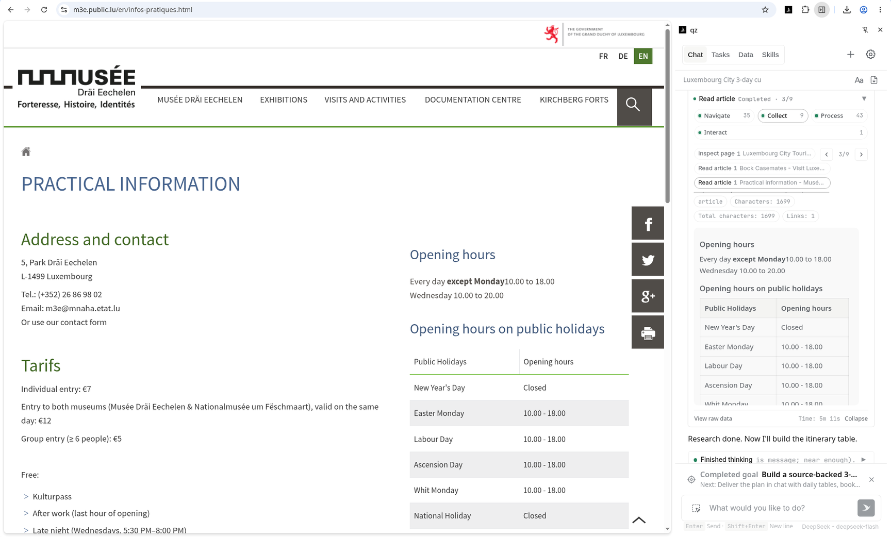
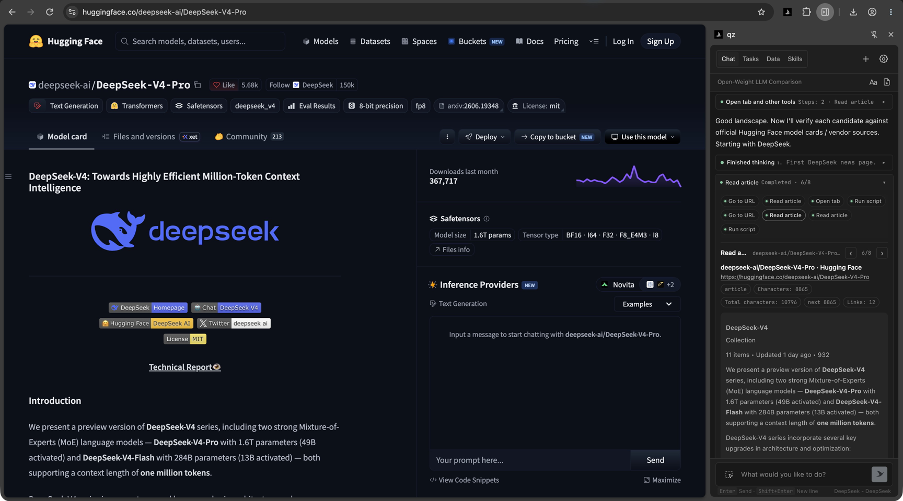
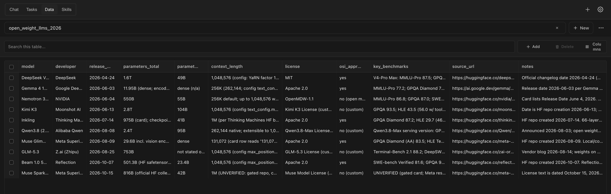
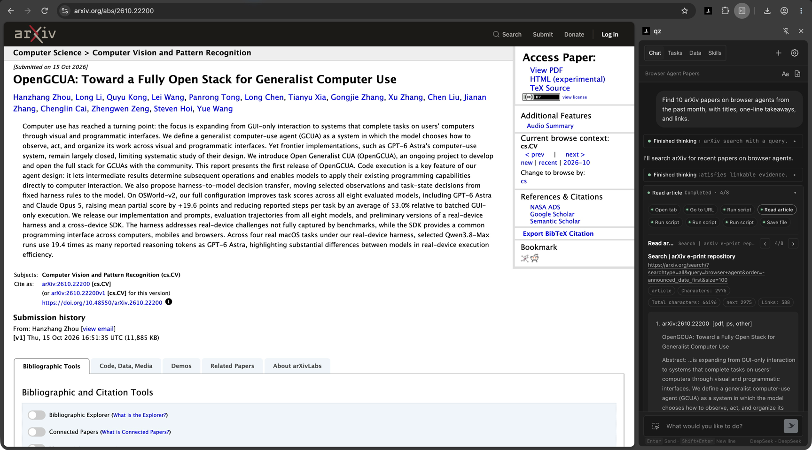
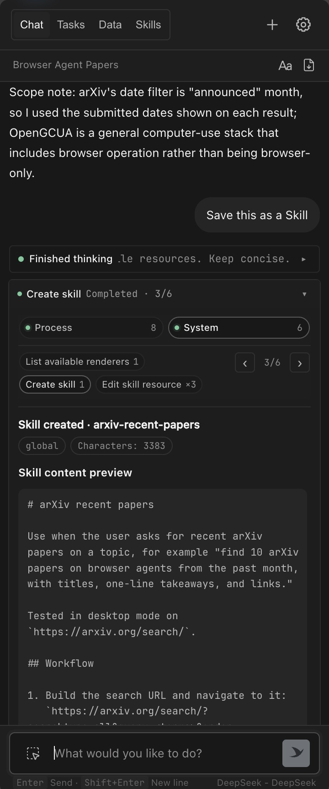
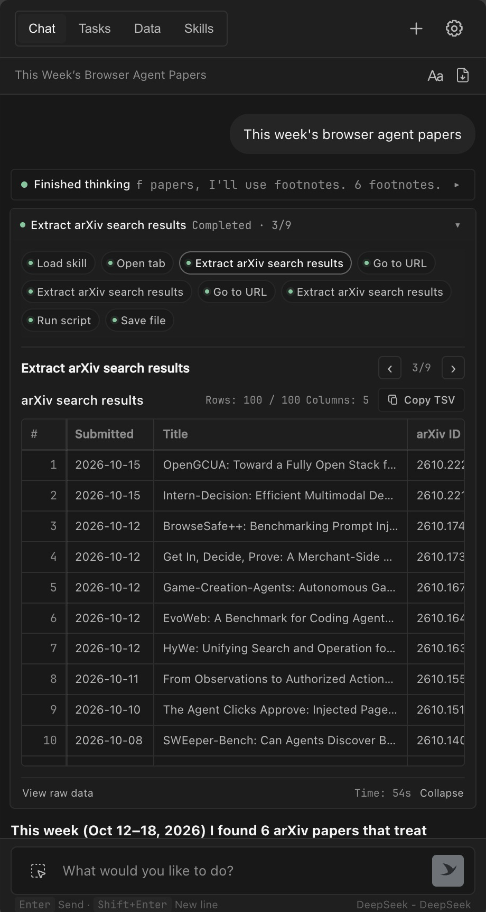
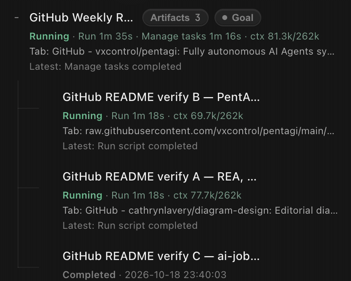
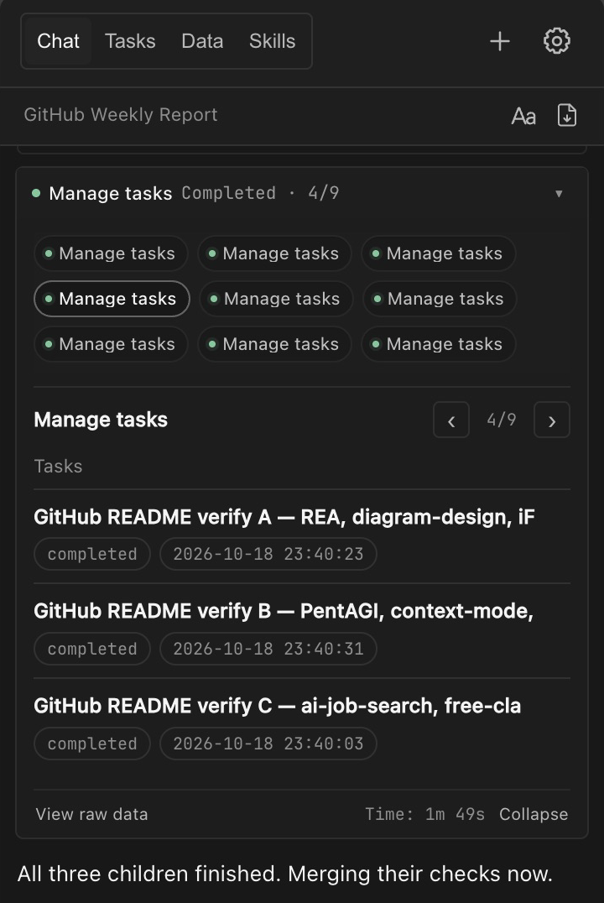
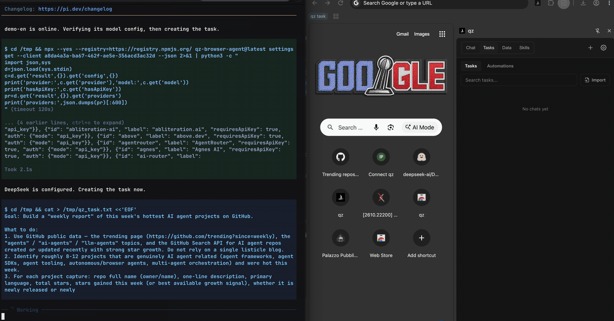
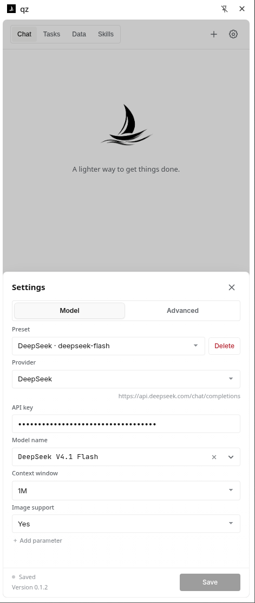

<p align="center">
  
</p>
<h1 align="center">qz</h1>
<p align="center">English · <a href="README.zh-CN.md">简体中文</a> · <a href="https://alibaba.github.io/qz-browser-agent/">Website</a></p>
<p align="center">Open-source, local-first browser agent</p>
<p align="center">Bring your own model · Research · Automate · Extract</p>

<div align="center">

[](https://chromewebstore.google.com/detail/dknbdgkgoinlgjpfebapkklbmjjgdblm) [](https://www.npmjs.com/package/qz-browser-agent) [](LICENSE) [](https://github.com/alibaba/qz-browser-agent/actions/workflows/ci.yml)

</div>

qz is an open-source browser agent that runs in your own browser as a Chrome extension. Describe a task in one sentence, and it works across the sites you're already signed in to, extracts the data, and delivers tables, files, or reports with sources. Connect any model, including DeepSeek, OpenAI, and Claude, with your own API key; your data stays local and goes only to the model you choose. Agents like Grok Bot, Claude Code, and Codex can also hand web tasks to qz through its CLI and MCP.

<p align="center">
  <a href="https://chromewebstore.google.com/detail/dknbdgkgoinlgjpfebapkklbmjjgdblm"></a>
</p>

<p align="center">
  <a href="#make-your-agents-actually-good-at-browsing"></a>
</p>


https://github.com/user-attachments/assets/26ee85fd-540f-4427-af59-c196fadfa221

## Why qz?

### Reliable browser execution for AI agents

General-purpose AI agents often break on real-world browsing: login walls, long click sequences, and pages that load as you scroll. qz runs these flows in your real local Chrome and hands clean results back to your agent.

### Visible to you, callable by your agent

Other browser agents usually let you watch them work, but stepping in mid-task is hard, and each is built for either people or agents, not both. qz lives in the side panel, so you see every step and result, and you can step in or stop it at any time. Coding agents such as Claude Code and Codex can also send tasks to qz through the CLI or MCP.

### Parallel research, from web data to reusable Skills

qz runs many tasks at once, and each task can spawn subtasks, so a large research job is split up and worked in parallel instead of stalling a single agent. It pulls the figures you want to compare from scattered, inconsistent websites and turns them into comparison tables or local files. Once a task works, say "Save this as a Skill" and reuse it next time with one sentence.

### Your everyday browser, your data stays local

No virtual environment to set up. qz uses the Chrome you already use, so your logins, cookies, and extensions just work. Task data is stored locally, and you choose the model behind it.

## What you can ask

### Start with a simple task

```text
Plan a 3-day cultural walk through Luxembourg City linking the Old Town, museums, and historic quarters. Check tourism-office and venue websites for opening hours, tickets, and booking rules, build a daily route table with sources, and flag anything unverified.
```

<p align="center">
  
</p>

<p align="center"><sub>Gathers from multiple sources and switches on Goal mode automatically.</sub></p>

### Pull together multiple sources

```text
Compare the major open-weight LLMs released in the last 6 months, one per row: release date, parameters, context length, license, and key benchmarks, with official sources.
```

<p align="center">
  
</p>

<p align="center">
  
</p>

<p align="center"><sub>Organizes the findings into a data table.</sub></p>

### Get it right once, save it as a Skill in one sentence

```text
Find 10 arXiv papers on browser agents from the past month, with titles, one-line takeaways, and links.
```

Once it works, say "Save this as a Skill". Next time, just say "This week's browser agent papers" to reuse it.

<p align="center">
  
</p>

<p align="center">
  
  
</p>

### Run research tasks in parallel

```text
Find the 10 fastest-growing AI agent repos on GitHub this week, read their READMEs, and write a weekly report with links.
```

<p align="center">
  
  
</p>

### Let your agent hand tasks to qz

In a coding agent such as pi, say:

```text
Use qz to find this week's hottest AI agent projects on GitHub and send me a weekly report.
```

<p align="center">
  
</p>

## Quick start

1. **Install**: Click **Add to Chrome** on the [Chrome Web Store](https://chromewebstore.google.com/detail/dknbdgkgoinlgjpfebapkklbmjjgdblm), then click the qz icon in your toolbar to open the side panel.
2. **Connect a model**: Open **Settings**, select a provider (e.g., DeepSeek, Claude), paste your API key, and save. Have a ChatGPT account? Select **OpenAI Codex** and sign in—no API key required.

   

3. **Run a task**: Enter a prompt in the side panel, for example:
   ```text
   Find this year's Nobel Prize winners in every category and put them in a table with source links.
   ```
4. **(Optional) Connect external agents**: Run `npx --yes qz-browser-agent@latest connect` in your terminal to let other agents trigger qz. See [Make your agents actually good at browsing](#make-your-agents-actually-good-at-browsing) for details.

<details id="manual-installation">
<summary>Can't access the Chrome Web Store? Install manually</summary>

1. Download the ZIP from the [latest release](https://github.com/alibaba/qz-browser-agent/releases/latest) and extract it.
2. Open `chrome://extensions` and enable **Developer mode**.
3. Click **Load unpacked** and select the extracted `qz-browser-agent-extension` folder.
4. Open the side panel and configure a model as described above.

</details>

## Make your agents actually good at browsing

Agents like Grok Bot, Claude Code, Codex, and pi can hand web tasks to qz. qz runs them in your browser's side panel, where you can watch every step, then returns the results so your agent can keep going.

1. **Install the Skill** so your agent knows how to use qz.
   ```bash
   npx skills add alibaba/qz-browser-agent -g
   ```
2. **Pair once.** Requires Node.js 22 or later. The command pairs automatically with your default browser.
   ```bash
   npx qz-browser-agent@latest connect
   ```
3. **Just ask.** Tell your agent: "Use qz to compare open-weight LLMs released in the last 6 months and put them in a table with sources."

<details>
<summary>Use the CLI or MCP directly</summary>

```bash
npx qz-browser-agent@latest create "your task" --stream
```

- `--stream` shows progress, any questions qz needs you to answer, and the final result.
- For MCP clients, run `npx qz-browser-agent@latest mcp` after pairing and use the HTTP URL it returns.
- For regular use, install globally with `npm install --global qz-browser-agent`, then use `qz` in place of `npx qz-browser-agent@latest`.
- See the [CLI and MCP reference](docs/cli.md) for multi-browser pairing, follow-ups, and exports.

</details>

## Comparison

| | **qz** | Nanobrowser | Browser Use | agent-browser | Playwright MCP |
| --- | :-: | :-: | :-: | :-: | :-: |
| **Delegate the whole task, not every click** | ✅ | ◐ | ◐ | ◐ | ❌ |
| **Runs in your own logged-in Chrome** | ✅ | ✅ | ◐ | ◐ | ◐ |
| **Real-time control of every step, for humans and agents** | ✅ | ◐ | ◐ | ◐ | ◐ |
| **Many tasks in parallel, each with subtasks** | ✅ | ◐ | ◐ | ◐ | ◐ |
| **Save a run as a reusable Skill** | ✅ | ❌ | ◐ | ❌ | ❌ |

<sub>✅ built in · ◐ partial or needs setup/code · ❌ not supported. As of October 2026, based on each project's public docs.</sub>

## Local first

qz runs entirely in your browser. Sessions, Skills, and collected data stay on your machine, and the CLI/MCP bridge runs locally too. There's no qz server: your data only goes to the model you configure and the websites you work on.

See [privacy policy](docs/permissions.md) and [browser permissions](docs/permissions.md#browser-access).

## FAQ

### Is qz free?

The extension and CLI are free under [Apache-2.0](LICENSE). Model costs depend on your provider;
compatible local models are supported. ChatGPT access and limits depend on your account and
[plan](https://learn.chatgpt.com/docs/pricing).

### How do I sign in with ChatGPT?

In **Settings**, select **OpenAI Codex** and follow the device-code instructions at `auth.openai.com`.
Return to qz, select a model, and save. If device-code login is disabled, follow OpenAI's
[authentication guidance](https://learn.chatgpt.com/docs/auth#preferred-device-code-authentication-beta).

### Which models can I use?

Use a provider with a supported protocol and tool calling, including a compatible local server.
Presets include **OpenAI Codex**, **OpenRouter**, **DeepSeek**, **Kimi For Coding**, **OpenCode Go**,
**OpenCode Zen**, **Fireworks AI**, and more. See [providers](docs/providers.md).

### Does qz support Edge or Firefox?

qz releases run in Chrome and Edge. A signed Firefox listing is not published yet. Temporary loading
for development is in [Load temporarily in Firefox](docs/commands.md#load-temporarily-in-firefox).
The CLI is the same daemon for both packages. Pairing is in
[Load qz in Firefox](docs/cli.md#load-qz-in-firefox).
The packaging convention is in [Firefox packaging](docs/firefox-packaging.md).
`npm run dev` and `npm run build` write the Chrome package. `npm run dev:firefox` and
`npm run build:firefox` write the Firefox package. `npm run release` writes the Chrome zip.
`npm run release:firefox` writes an unsigned `.xpi` for a local check or an AMO upload.
Remaining differences from Chrome are in
[Firefox differences from Chrome](docs/firefox-differences.md). The API survey is in
[Firefox capability gap](docs/firefox-capability-gap.md).

## Development

To change qz's behavior or inspect how it runs, build and load the extension locally.

### Build from source

Install Node.js 24 LTS and npm, then run from a local checkout:

```bash
npm ci
npm run build
```

Open `chrome://extensions`, enable **Developer mode**, click **Load unpacked**, and select
`dist/extension/`. To load the same sources in Firefox temporarily, follow
[Load temporarily in Firefox](docs/commands.md#load-temporarily-in-firefox).

### Develop and test

Set up the [test environment](docs/commands.md#run-tests), then use:

```bash
npm run dev            # Rebuild the Chrome package on source changes
npm run dev:firefox    # Rebuild the Firefox package on source changes
npm test               # Run the default test suites
npm run verify         # Type-check and run the shared suites
npm run verify:chrome  # Chrome package suites on dist/extension
npm run verify:coverage # Shared suites, Chrome package suites, and coverage gates
```

After a rebuild, reload the extension at `chrome://extensions` and reopen the side panel.

### Add a capability

To add a tool, view, setting, or provider that qz doesn't include yet, see the [capability guide](src/capabilities/README.md).

### More docs

- [Architecture](docs/architecture.md)
- [Commands and build options](docs/commands.md)
- [Contributing](CONTRIBUTING.md)

## License

For reuse or redistribution, follow [Apache-2.0](LICENSE) and the dependencies' own licenses listed
in [THIRD_PARTY_NOTICES.md](THIRD_PARTY_NOTICES.md).
