<p align="center">
  
</p>
<h1 align="center">轻舟（qz）</h1>
<p align="center"><a href="README.md">English</a> · 简体中文 · <a href="https://alibaba.github.io/qz-browser-agent/">官网</a></p>
<p align="center">开源、本地优先的浏览器 Agent</p>
<p align="center">支持任意模型 · 调研 · 自动化 · 数据提取</p>

<div align="center">

[](https://chromewebstore.google.com/detail/dknbdgkgoinlgjpfebapkklbmjjgdblm) [](https://www.npmjs.com/package/qz-browser-agent) [](LICENSE) [](https://github.com/alibaba/qz-browser-agent/actions/workflows/ci.yml)

</div>

轻舟（qz）是一个运行在你浏览器里的开源浏览器 Agent（Chrome 扩展）。一句话描述任务，它就会在你已登录的网站上自动操作、提取数据，交付表格、文件或带出处的报告。可接入 DeepSeek、OpenAI、Claude 等任意模型，用自己的 API Key，数据留在本地，只发给你选的模型；Grok Bot、Claude Code、Codex 等 Agent 也能通过 CLI 和 MCP 把网页任务交给它。

<p align="center">
  <a href="https://chromewebstore.google.com/detail/dknbdgkgoinlgjpfebapkklbmjjgdblm"></a>
</p>

<p align="center">
  <a href="#让你的-agent-更会用浏览器">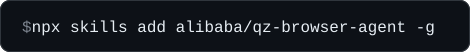</a>
</p>


https://github.com/user-attachments/assets/3203bc89-ef26-4f66-86cc-b602a912a1ab

## 为什么用轻舟？

### 解决 Agent 网页交互的“最后一公里”

通用 AI Agent 并不擅长复杂的浏览器操作，遇到登录墙、连续点击或异步翻页极易中断。轻舟相当于为你的 Agent 挂载了一个真实的本地 Chrome，在真实环境里跑完复杂流程，再将干净的结果返回。

### 透明可见，人与 Agent 协同

其他 browser agent 大多能看到执行过程，但中途很难介入，而且要么只给人用，要么只给 Agent 用。轻舟常驻在浏览器侧边栏，每一步操作和结果都清晰可见，你可以随时介入或停止。同时，Claude Code、Codex 等 coding agent 也能通过 CLI 和 MCP 直接向轻舟下发任务。

### 并行多任务调研，从网页数据到可复用 Skill

告别在十几个标签页之间反复横跳与手动清洗数据。轻舟可以同时运行大量任务，每个任务还能派生子任务分头执行，把单个 browser agent 难以完成的大规模调研拆开并行推进。面对分散在不同网站、结构混乱的网页信息，轻舟能跨站点自动提取你需要比对的参数，并附带来源链接；将异构的网页内容直接整理为标准化的对比视图或本地文件，无缝接入你的分析流。跑通的流程还能直接沉淀为 Skill，下次只需一句话即可复用。

### 原生浏览器环境，数据纯本地留存

告别繁琐的虚拟环境配置。轻舟直接调用你日常使用的 Chrome，现有的登录状态、Cookie 和扩展程序即插即用。任务数据完全存储在本地，底层大模型由你自主配置，安全可控。

## 可以让轻舟做什么

### 从一个简单的任务开始

```text
规划 3 天杭州文化漫游，串联西湖、博物馆与历史街区。查阅文旅部门和场馆官网，核对开放时间、门票与预约要求，整理每日路线表并附来源，未核实处标明。
```

<p align="center">
  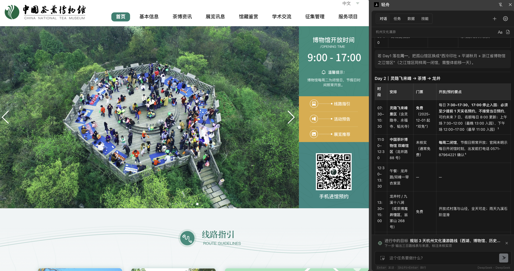
</p>

<p align="center"><sub>多来源收集，自动开启目标模式。</sub></p>

### 多来源信息整理

```text
对比最近 6 个月发布的主流开源大模型，每行一个模型：发布日期、参数量、上下文长度、协议、主要基准成绩，附官方来源。
```

<p align="center">
  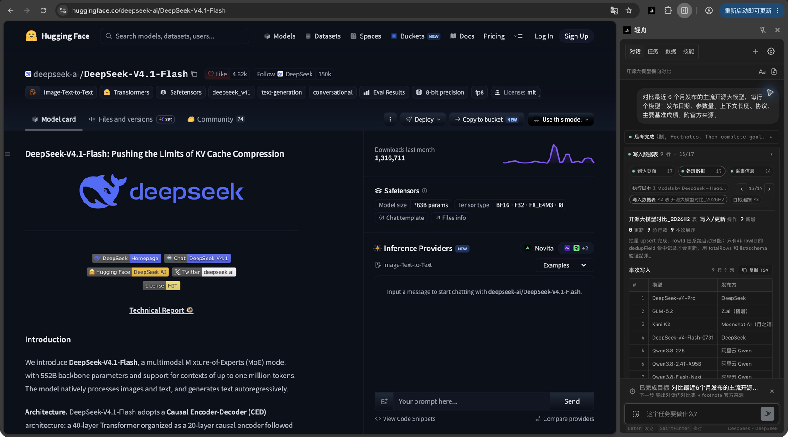
</p>

<p align="center">
  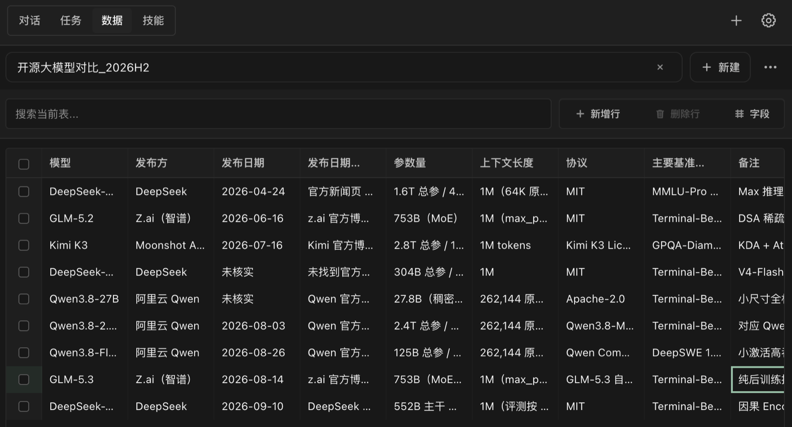
</p>

<p align="center"><sub>将信息整理至数据表中。</sub></p>

### 跑通一次，一句话存成 Skill

```text
找 arXiv 上最近一个月关于 browser agent 的 10 篇论文，整理标题、一句话结论和链接。
```

跑通后说一句“保存为 Skill”，下次只要说“本周的 browser agent 论文”就能复用。

<p align="center">
  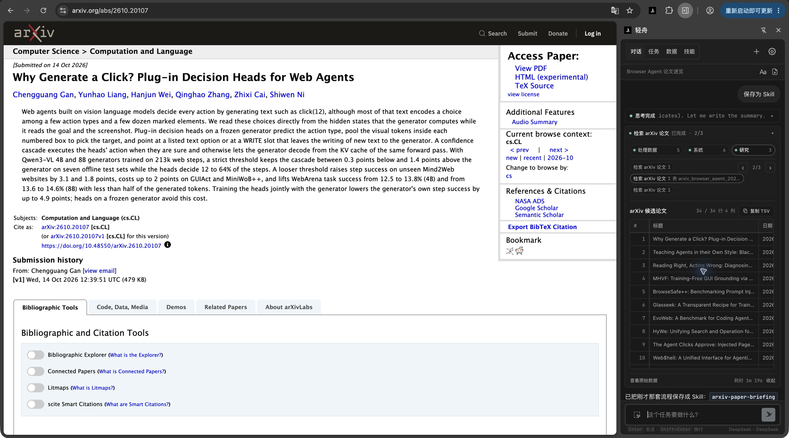
</p>

<p align="center">
  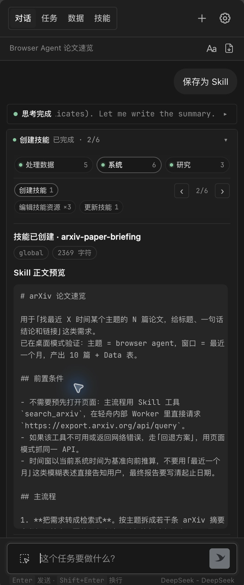
  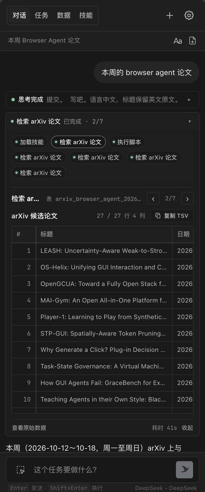
</p>

### 多任务并行调研

```text
找出 GitHub 上本周 star 涨得最快的 10 个 AI agent 项目，读完 README，写一份带链接的周报。
```

<p align="center">
  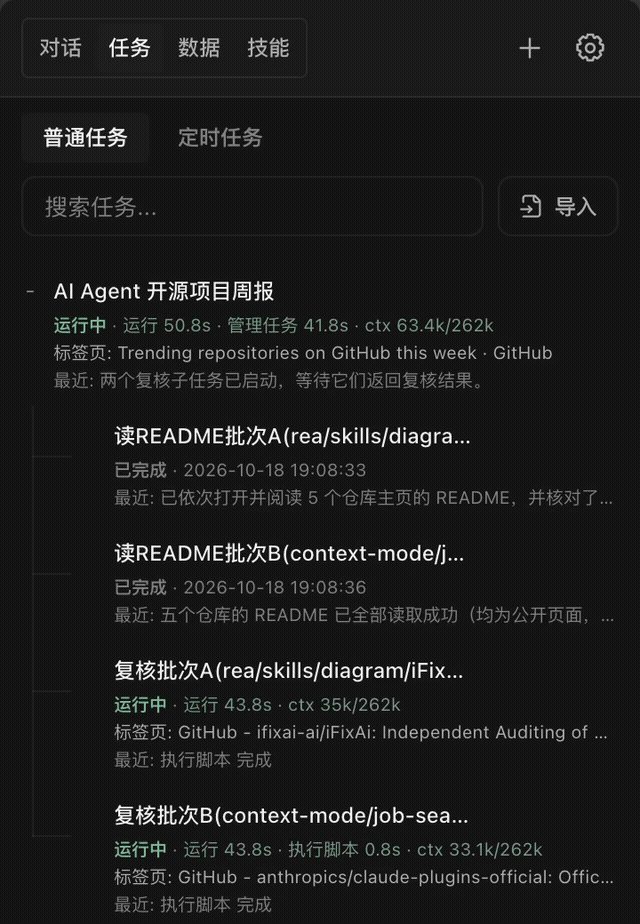
  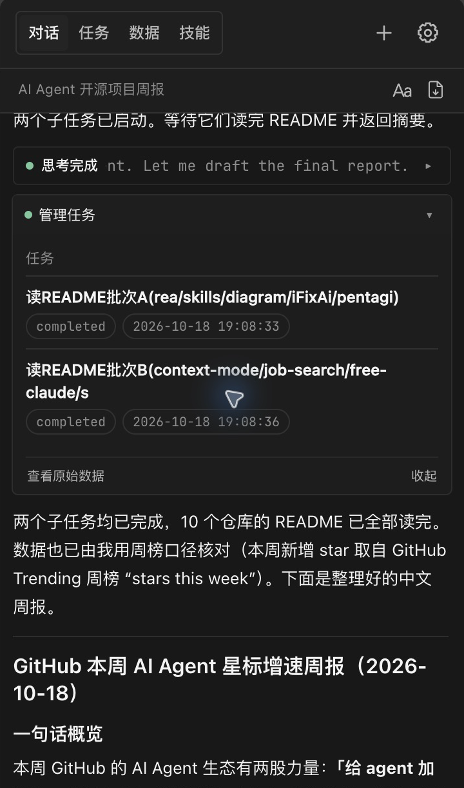
</p>

### 让你的 Agent 把任务交给轻舟

在 pi 等编程 Agent 里说：

```text
用轻舟查本周 GitHub 上最火的 AI agent 项目，整理成周报发给我。
```

<p align="center">
  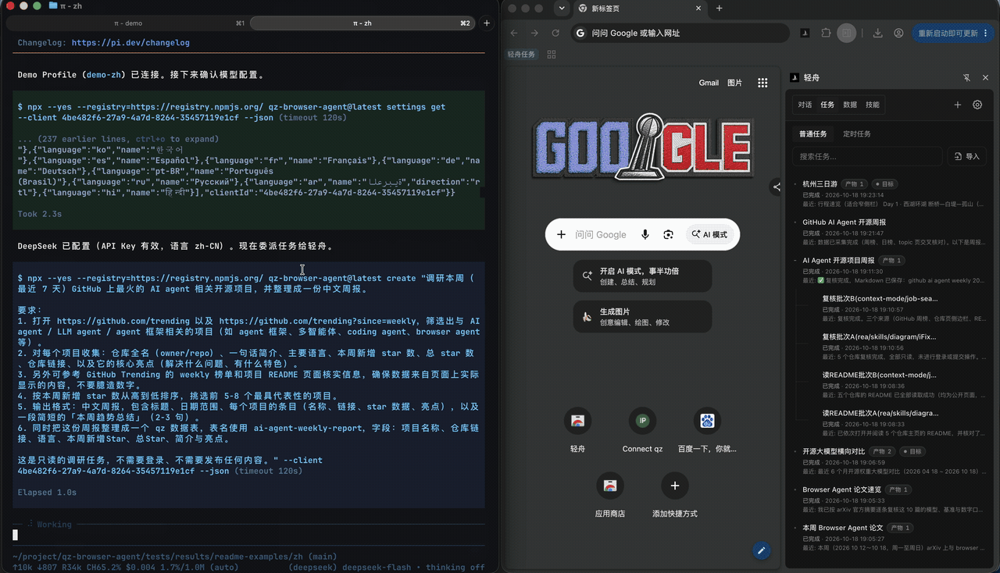
</p>

## 快速开始

1. **安装扩展**：前往 [Chrome 应用商店](https://chromewebstore.google.com/detail/dknbdgkgoinlgjpfebapkklbmjjgdblm)点击**添加至 Chrome**，完成后点击浏览器工具栏上的轻舟图标，唤起侧边栏。
2. **接入模型**：进入**设置**，选择模型服务商（如 DeepSeek、Claude），填入 API Key 并保存。若已有 ChatGPT 账号，可直接选择 **OpenAI Codex** 登录，免填 Key。

   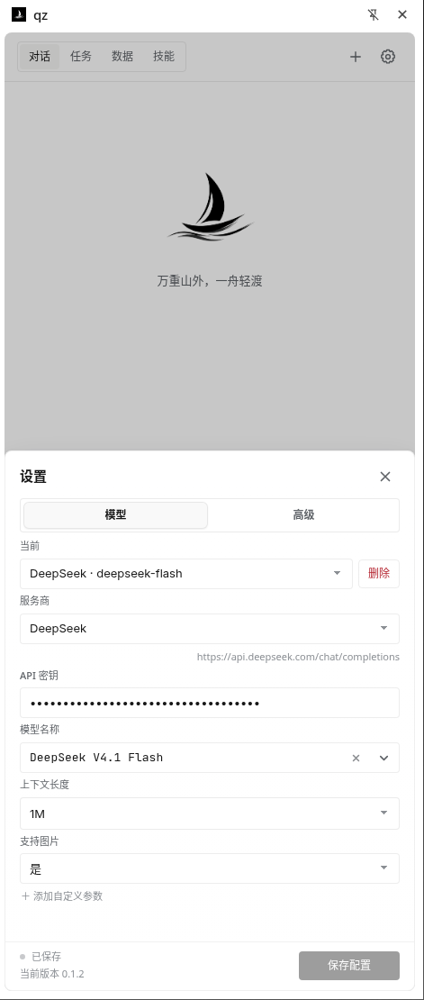

3. **运行任务**：在侧边栏输入你的指令，例如：
   ```text
   查今年诺贝尔奖各奖项得主，整理成带来源链接的表格。
   ```
4. **（可选）接入其他 Agent**：在终端运行 `npx --yes qz-browser-agent@latest connect`，即可让外部 Agent 调用轻舟。详见 [让你的 Agent 更会用浏览器](#让你的-agent-更会用浏览器)。

<details id="手动安装">
<summary>无法访问 Chrome 应用商店？手动安装</summary>

1. 下载[最新版本](https://github.com/alibaba/qz-browser-agent/releases/latest)中的 ZIP 安装包并解压。
2. 打开 `chrome://extensions`，启用**开发者模式**。
3. 点击**加载已解压的扩展程序**，选择解压后的 `qz-browser-agent-extension` 文件夹。
4. 打开侧边栏，按上面的说明配置模型。

</details>

## 让你的 Agent 更会用浏览器

Grok Bot、Claude Code、Codex、pi 等 Agent 遇到网页任务时，可以把它交给轻舟。轻舟在你的浏览器侧边栏里执行，过程看得见，结果再交回给 Agent，让它接着往下做。

1. **安装 Skill**：让你的 Agent 学会怎么调用轻舟。
   ```bash
   npx skills add alibaba/qz-browser-agent -g
   ```
2. **配对一次**：需要 Node.js 22 及以上版本，运行后会自动在你的默认浏览器里完成配对。
   ```bash
   npx qz-browser-agent@latest connect
   ```
3. **直接吩咐**：跟你的 Agent 说“用轻舟对比最近 6 个月发布的开源大模型，整理成带来源的表格”。

<details>
<summary>直接用 CLI 或 MCP</summary>

```bash
npx qz-browser-agent@latest create "你的任务" --stream
```

- `--stream` 会实时显示任务进展、需要你回答的问题和最终结果。
- 用 MCP 客户端的话，配对后运行 `npx qz-browser-agent@latest mcp`，填入它返回的 HTTP 地址即可。
- 经常使用的话，可以运行 `npm install --global qz-browser-agent` 全局安装，之后用 `qz` 代替 `npx qz-browser-agent@latest`。
- 多浏览器配对、追问、导出等用法见 [CLI 与 MCP 参考](docs/cli.md)。

</details>

## 与同类项目对比

| | **轻舟** | Nanobrowser | Browser Use | agent-browser | Playwright MCP |
| --- | :-: | :-: | :-: | :-: | :-: |
| **整个任务交给它，不用一步步指挥** | ✅ | ◐ | ◐ | ◐ | ❌ |
| **直接用你已登录的 Chrome** | ✅ | ✅ | ◐ | ◐ | ◐ |
| **实时掌控每一步，人和 Agent 都能用** | ✅ | ◐ | ◐ | ◐ | ◐ |
| **多任务并行，每个任务还能拆子任务** | ✅ | ◐ | ◐ | ◐ | ◐ |
| **跑通的流程存成可复用的 Skill** | ✅ | ❌ | ◐ | ❌ | ❌ |

<sub>✅ 内置支持 · ◐ 部分支持或需配置/写代码 · ❌ 不支持。截至 2026 年 10 月，依据各项目公开文档。</sub>

## 本地优先

轻舟完全运行在你的浏览器里。会话、Skill 和采集的数据都保存在本地，CLI/MCP 桥接服务同样运行在你的本机上。轻舟没有后台服务器，数据只会发给你配置的模型，以及任务直接访问的网站。

详见[隐私政策](docs/permissions.md)与[浏览器权限](docs/permissions.md#browser-access)。

## 常见问题

### 轻舟免费吗？

扩展和 CLI 按 [Apache-2.0](LICENSE) 免费提供。模型费用取决于服务商，也支持兼容的本地模型。ChatGPT 的权限和额度取决于你的账号及[套餐](https://learn.chatgpt.com/docs/pricing)。

### 怎么用 ChatGPT 账号登录？

在**设置**中选择 **OpenAI Codex**，按设备码提示在 `auth.openai.com` 完成登录。回到轻舟，选择模型并保存。如果设备码登录未启用，请按 OpenAI 的[认证说明](https://learn.chatgpt.com/docs/auth#preferred-device-code-authentication-beta)操作。

### 支持哪些模型？

支持协议兼容且具备工具调用能力的服务商，包括兼容的本地模型服务。预设包括 **OpenAI Codex**、**OpenRouter**、**DeepSeek**、**Kimi For Coding**、**OpenCode Go**、**OpenCode Zen** 和 **Fireworks AI** 等。详见[服务商文档](docs/providers.md)。

### 支持 Edge 或 Firefox 吗？

发布版本运行在 Chrome 和 Edge。Firefox 尚未发布。开发时的临时加载见
[在 Firefox 中临时加载](docs/commands.md#load-temporarily-in-firefox)。与 Chrome 仍有差异的行为见
[Firefox 与 Chrome 的差异](docs/firefox-differences.md)。API 调查见
[Firefox 能力差](docs/firefox-capability-gap.md)。

## 开发

需要修改轻舟的行为或检查其运行方式时，可以在本地构建并加载扩展。

### 从源码构建

安装 Node.js 24 LTS 和 npm，然后在本地仓库中运行：

```bash
npm ci
npm run build
```

打开 `chrome://extensions`，启用**开发者模式**，点击**加载已解压的扩展程序**，选择 `dist/extension/`。
在 Firefox 中临时加载同一套源码，见[在 Firefox 中临时加载](docs/commands.md#load-temporarily-in-firefox)。

### 开发与测试

完成[测试环境配置](docs/commands.md#run-tests)后，使用以下命令：

```bash
npm run dev             # 源码变更后自动重新构建
npm test                # 运行默认测试
npm run verify          # 类型检查，并运行共享测试
npm run verify:chrome   # 加载 dist/extension/ 的 Chrome 套件
npm run verify:coverage # 共享套件、Chrome 套件，以及覆盖率门禁
```

重新构建后，在 `chrome://extensions` 中重新加载扩展，并重新打开侧边栏。

### 添加能力包

想添加轻舟还没有的工具、视图、设置或服务商，见[能力包指南](src/capabilities/README.md)。

### 更多文档

- [架构](docs/architecture.md)
- [命令与构建选项](docs/commands.md)
- [贡献指南](CONTRIBUTING.md)

## 许可证

复用或分发时，请遵循 [Apache-2.0](LICENSE) 及第三方依赖各自的许可证，详见 [THIRD_PARTY_NOTICES.md](THIRD_PARTY_NOTICES.md)。

---

> 两岸猿声啼不住，轻舟已过万重山。<br>
> —— 李白《早发白帝城》
