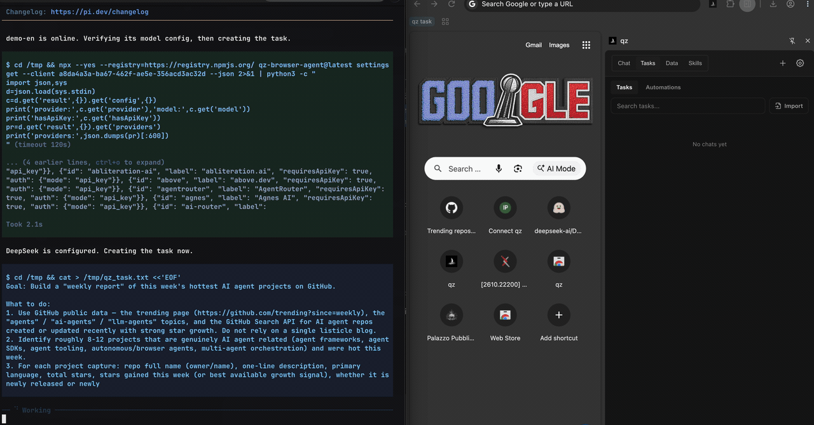

# qz

An open-source browser agent for humans and coding agents.

qz is a local-first extension for Chrome and Edge.
People use it from the side panel; agents such as Claude Code, Codex, and pi hand it web tasks
through this CLI or MCP. qz works in your own browser, with your existing logins, and returns
tables, files, or reports with sources. Everything runs locally, and your data goes only to the
model you choose.

[Website](https://alibaba.github.io/qz-browser-agent/) ·
[GitHub](https://github.com/alibaba/qz-browser-agent) ·
[Chrome Web Store](https://chromewebstore.google.com/detail/dknbdgkgoinlgjpfebapkklbmjjgdblm) ·
[Full CLI and MCP reference](https://github.com/alibaba/qz-browser-agent/blob/main/docs/cli.md)



## Quick start

Requires Node.js 22 or later.

1. **Install the extension.** Click **Add to Chrome** on the
   [Chrome Web Store](https://chromewebstore.google.com/detail/dknbdgkgoinlgjpfebapkklbmjjgdblm),
   open the qz side panel, and choose a provider and model in **Settings**.
2. **Run your first task.** The CLI prepares the browser connection automatically. Complete the
   extension’s connection prompt when needed.

   ```bash
   npx qz-browser-agent@latest create "Find this year's Nobel Prize winners in every category and put them in a table with source links." --stream
   ```

   `--stream` shows progress, any questions qz needs you to answer, and the final result.

For regular use, install the `qz` command globally and use it in place of
`npx qz-browser-agent@latest`:

```bash
npm install --global qz-browser-agent@latest
qz --version
```

For direct browser control, read the guide shipped with your installed CLI:

```bash
qz skill
qz session create --title "Read example page"
qz script --session SESSION_ID task.js --args '{"query":"example"}'
qz session show SESSION_ID
qz session cancel SESSION_ID
```

Browser operations prepare their connection automatically: they reuse the first responding
online browser, or open the connection page once in the system default browser when it uses Chromium or Firefox.
For another default browser, use `qz connect uri` to pair a supported browser.
Select an existing profile with --client NAME|UUID; it never falls back to another profile. An incompatible
local service is restarted once before browser operations. Complete the extension’s connection
prompt when needed.

Scripts run outside pages and use the `qz` SDK. Bind `qz.tab(tabRef)` for page operations,
use `page.locator(query)` for element actions and waits, and `page.evaluate(code,args?)` for DOM access.
Discover additional capabilities with `qz.listTools()` or `qz.listTools({names:["list_images"]})`,
then invoke them through `qz.call(name,args)`. stdout is JSON `{ok,result,trace}`: execution status, the returned business value,
and ordered error and `trace()`/`console` messages without levels. Failures put `ToolError` in `result`; `undefined`
returns become `null`. The built-in agent delegation commands above remain available when
qz should plan and execute the task.

## Connect an MCP client

Print the MCP URL; this starts the local service if needed:

```bash
npx qz-browser-agent@latest mcp
```

The default is `http://127.0.0.1:18765/mcp`; use the URL your command prints if the port differs.

**Codex** (`~/.codex/config.toml`):

```toml
[mcp_servers.qz]
url = "http://127.0.0.1:18765/mcp"
```

**Claude Code**:

```bash
claude mcp add --transport http qz http://127.0.0.1:18765/mcp
```

**Clients with an `mcpServers` JSON config**, such as Cursor:

```json
{
  "mcpServers": {
    "qz": { "url": "http://127.0.0.1:18765/mcp" }
  }
}
```

CLI and MCP share the same browser connection. The MCP tool list is in the
[reference](https://github.com/alibaba/qz-browser-agent/blob/main/docs/cli.md#task-and-resource-operations).

## Common commands

| Command | What it does |
| --- | --- |
| `qz connect uri` | Print a URL to open in a chosen browser profile |
| `qz status` | Check the connection and service address |
| `qz cleanup` | Stop registered local services and remove runtime files and logs |
| `qz browsers` | List paired browsers, or `forget` an offline one |
| `qz create "PROMPT"` | Start a task; add `--stream` or `--wait` to follow it |
| `qz send TASK_ID "MESSAGE"` | Send a follow-up, or `--steer` the current run |
| `qz tasks` | List tasks |
| `qz show TASK_ID` | Read a task's status, response, or pending question |
| `qz watch TASK_ID` | Follow a task until its work and queued messages finish |
| `qz submit` / `approve` / `reject` | Answer a question or permission request |
| `qz cancel TASK_ID` | Stop a task |
| `qz data` | List, export, or delete data tables |
| `qz images` | List, export, or delete image collections |
| `qz skills` | Find, read, or export Skills |
| `qz settings` | Read or update settings |
| `qz automations` | List or run automations |

With several browser profiles connected, choose one with `--client NAME|UUID` (or `-c`).
Run `qz COMMAND --help` for options. Interactive terminals show readable text; pipes receive JSON.

`watch`, `--wait`, and `--stream` follow the same task across runs until its current work and
accepted follow-ups and steering messages have completed and its queues are empty. Questions
and permission requests keep observation open. Task failure or stopping ends observation.
Timeout or Ctrl-C ends observation while the browser task continues; execute the returned
`watch` command with the same task ID and browser UUID to resume. Observation never resends messages.

## Privacy and local access

The service accepts connections only on your computer, and ordinary websites cannot use its MCP
endpoint. Local programs can control connected qz tasks while the service is running. Disconnect
a profile in its qz connection settings; task cancellation remains a separate operation.
Run `qz cleanup` to stop local services across installations and remove their runtime files and logs.
It preserves browser registrations, tabs, tasks and saved data; the next browser command starts its
service automatically. Active CLI requests and direct-drive scripts are interrupted; side-panel tasks
continue. `QZ_STATE_DIR` selects a different runtime directory when set.
Connection settings are stored in `~/.qz-browser-agent/run/`, and pairing credentials never
leave your computer.

## Reference

See the [qz CLI and MCP reference](https://github.com/alibaba/qz-browser-agent/blob/main/docs/cli.md)
for pairing a specific browser profile, Windows PowerShell notes, updates, task responses,
exports, output formats, exit codes, and the MCP tool mapping.

## License

[Apache-2.0](https://github.com/alibaba/qz-browser-agent/blob/main/LICENSE)
